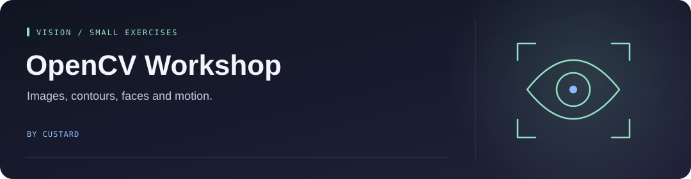

<!-- Project artwork created for this repository. -->
<p align="center">
  
</p>

<h1 align="center">OpenCV Workshop</h1>

<p align="center">
  
</p>

**Small Python exercises for images, contours, faces, and motion tracking.**

<p align="center"><a href="#explore-the-lessons">Explore the lessons</a> &nbsp; · &nbsp; <a href="#try-an-exercise">Try an exercise</a> &nbsp; · &nbsp; <a href="#credits">Credits</a></p>

## Explore the lessons

| Lesson | Topics |
| --- | --- |
| [1 · Basics](Lesson%201%20-%20Basics/) | Read images/video, resize, draw, blur, and transform |
| [2 · Image manipulation](Lesson%202%20-%20Advanced%20Manipulation/) | Contours, shapes, lines, color channels, and masks |
| [3 · Faces](Lesson%203%20-Faces/) | Detection, training, and recognition |
| [4 · Hand and body tracking](Lesson%204%20-%20Hand%20and%20Body%20Tracking/) | Hand landmarks and pose experiments |

## Try an exercise

Use a separate Python environment. The basic and face lessons use OpenCV's contrib modules:

```bash
python -m pip install opencv-contrib-python numpy caer
python "Lesson 1 - Basics/1_read.py"
```

Check each script's image/video paths before running it. Tracking lessons have additional dependencies, and webcam exercises need camera access. This is historical workshop code; compatibility with current package versions has not been revalidated.

See the [original walkthrough and challenges](docs/WORKSHOP.md) for exercises and source notes.

## Credits

Workshop material from USRC, based on Jason Dsouza's freeCodeCamp OpenCV tutorial. See [Jason's channel](https://www.youtube.com/jasmcaus) and [Caer](https://github.com/jasmcaus/caer). The original notes credit Unsplash and Pixabay for images/videos and a Kaggle repository for face images; those assets have their own terms.

See [source and rights](docs/SOURCE_AND_RIGHTS.md) before reusing imported exercises or media.
